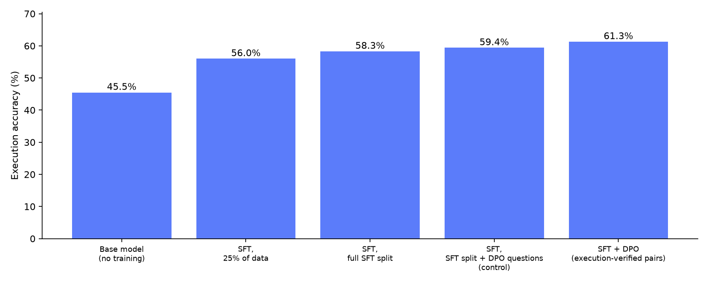

# Text-to-SQL: a post-trained model inside an NL→SQL agent

Two parts that work together:

1. **Post-training** (`t2s/`). Fine-tunes **Qwen2.5-Coder-0.5B-Instruct** on the
   [Spider](https://yale-lily.github.io/spider) benchmark with LoRA SFT, mines preference pairs by running the
   model's own SQL against the databases, trains DPO on those pairs, and evaluates every stage by
   **execution accuracy**. It asks how much SFT and DPO improve a small open model at writing SQL, and whether
   DPO on execution-checked pairs is a better use of extra questions than more SFT.
2. **The agent** (`app/`). A FastAPI + React app that connects to PostgreSQL, MySQL or SQLite, turns plain-English
   questions into SQL, runs it safely, and charts the results. It serves the post-trained model (adapter in
   `models/text2sql-qwen-dpo/`) next to general-purpose models from Ollama or OpenRouter, selectable in the UI.

## Results

Execution accuracy on all 1,034 Spider dev questions (one run, seed 0, a single Kaggle T4):

| Run | Execution acc. | vs base | SQL errors | Single table (333) | Group / order (211) | Join (331) | Nested / set ops (159) |
|---|---|---|---|---|---|---|---|
| Base model (no training) | 45.5% | | 37.6% | 62.5% | 56.9% | 30.5% | 25.8% |
| SFT, 25% of the SFT split | 56.0% | +10.5 pts | 26.0% | 74.5% | 69.2% | 37.5% | 38.4% |
| SFT, full SFT split | 58.3% | +12.9 pts | 21.1% | 75.1% | 65.9% | 42.3% | 46.5% |
| SFT on all questions (control) | 59.4% | +13.9 pts | 20.7% | 73.9% | 70.6% | 43.8% | 46.5% |
| **SFT + DPO** | **61.3%** | **+15.9 pts** | **16.5%** | **76.9%** | 67.3% | **48.6%** | **47.2%** |



**What the runs show**

- **SFT does most of the work.** It lifts execution accuracy from 45.5% to 58.3% and cuts queries that fail to run
  from 37.6% to 21.1%. A quarter of the SFT data already reaches 56.0%, so most of that gain comes early.
- **DPO on execution-verified pairs adds 3.0 points on top of SFT** (58.3% → 61.3%) and brings SQL errors down to
  16.5%. The largest gain is on joins (42.3% → 48.6%).
- **The control is closer.** Spending the same 2,000 questions on more SFT reaches 59.4%, so DPO comes out
  1.9 points ahead. With one seed and 1,034 questions the standard error is about 1.5 points per run, so this gap
  is a signal worth testing with more seeds, not a settled result.

**Preference pairs** (`results/pairs.stats.json`). The SFT model sampled 8 queries for each of the 2,000
held-out questions. 910 questions came back all correct (skipped), 894 mixed, 195 all wrong, and for 1 the gold
query itself failed. That gave 1,878 pairs, 1,496 of them with one of the model's own correct queries as the
chosen side. Of the 7,856 distinct sampled queries, 4,423 were correct, 1,504 ran but returned the wrong rows,
and 1,929 failed to execute.

**Compute.** About 4.5 hours on one T4: SFT 78 min, SFT on 25% 20 min, pair mining 30 min, DPO 25 min, the
SFT control 102 min, and about 3 min per evaluation.

## The agent

The app in `app/` serves the trained model directly: the backend loads Qwen2.5-Coder-0.5B-Instruct, merges the
LoRA adapter from `models/text2sql-qwen-dpo/` (the SFT + DPO run above, stored in fp16), and runs it on CPU or
GPU. No Ollama or API key is needed for it.

- **Same prompt as training.** For this model the backend sends the schema as `CREATE TABLE` statements of the
  tables in scope, with the same system prompt used in training, and reads back plain SQL. Other models keep the
  general JSON-planner prompt.
- **Model picker.** The navbar lists the post-trained model (marked *fine-tuned*) and the provider's models; the
  choice is sent with each query, and the SQL preview shows which model wrote the SQL.
- **Safety and confidence.** Its SQL goes through the same read-only checks and row limit as any other model.
  The confidence shown is the model's geometric-mean token probability for the query it wrote.
- **SQLite-trained.** The model was trained on SQLite; on PostgreSQL or MySQL it still works from the
  introspected schema, but check dialect-specific syntax.

**Run it**

```bash
# MongoDB (users and query history), e.g. locally with Docker
docker run -d --name nl2sql-mongo -p 27017:27017 -v nl2sql-mongo-data:/data/db mongo:7

# backend (Python 3.11+)
cd app/backend
pip install -e ".[finetuned]"     # drop [finetuned] to run without the local model
cp .env.example .env              # MONGO_URI (default mongodb://localhost:27017) and JWT_SECRET_KEY;
                                  # Ollama/OpenRouter settings are optional
uvicorn app.main:app --port 8000

# frontend
cd app/frontend
npm install
cp .env.example .env              # VITE_API_BASE_URL=http://localhost:8000
npm run dev                       # http://localhost:8080
```

The first start downloads the 0.5B base model (about 1 GB) and loads it in the background. On a laptop CPU a
query then takes a few seconds. `app/backend/README.md` covers authentication, the API and the other providers.

## Experiments

| Run | What changes | Question it answers |
|---|---|---|
| `base` | No training | Where does the model start? |
| `sft-25` | SFT on 25% of the SFT split | How much does SFT data size matter? |
| `sft` | SFT on the full SFT split (6,659 questions) | What does SFT alone achieve? |
| `dpo` | `sft` + DPO on pairs mined from 2,000 held-out questions | Does execution-verified DPO add on top of SFT? |
| `sft-all` | SFT on all 8,659 questions, including the 2,000 used for DPO | Control: is DPO better than just adding those questions to SFT? |

## Method

**Data.** Spider has 8,659 training and 1,034 dev questions over 200 SQLite databases. A seeded split holds
out 2,000 training questions for preference mining; SFT never sees them (except in the `sft-all` control).
The dev set is used only for the final evaluation.

**Prompt.** The system prompt asks for a single SQLite query. The user turn contains the database's
`CREATE TABLE` statements followed by the question. Training examples longer than 1,536 tokens are dropped
rather than truncated.

**SFT.** LoRA (r=16, alpha=32, all linear layers) trained with TRL's `SFTTrainer` for 2 epochs at
learning rate 2e-4 with a cosine schedule. Loss is computed on the SQL answer tokens only.

**Preference mining.** For each held-out question the SFT model samples 8 queries (temperature 1.0). Each
distinct query is executed against the database and compared with the gold result:

- some right, some wrong: chosen = a correct sample (on-policy), rejected = up to 2 wrong samples
- all wrong: chosen = the gold query, rejected = up to 2 wrong samples
- all right: skipped

Counts of each outcome are written to `data/pairs.stats.json`.

**DPO.** TRL's `DPOTrainer` continues training the SFT adapter, with a frozen copy of the SFT adapter as the
reference model (beta 0.1, learning rate 2e-5, 1 epoch).

**Evaluation.** Greedy decoding. A prediction counts as correct when it returns the same rows as the gold
query: compared as a multiset (in order only if the gold query has `ORDER BY`), ignoring column order, with
floats rounded to 4 decimals. Queries run on a read-only connection with a 10-second timeout. Accuracy is
also broken down by query structure (single table, group/order, join, nested/set operations).

## Reproduce

**Kaggle (free GPU).** Create a notebook from `notebooks/kaggle_pipeline.ipynb`, set the accelerator to a
GPU (T4 or P100) and turn on internet, then *Save & Run All*. Each stage is skipped if its output already
exists, so a re-run continues where it stopped.

**Any Linux machine with an NVIDIA GPU:**

```bash
pip install -r requirements.txt
pip uninstall -y torchao    # only if an old torchao (<0.16) is installed; PEFT refuses to load with it
bash scripts/smoke_gpu.sh   # a few minutes: every stage with tiny limits
bash scripts/run_pipeline.sh
```

**Single steps:**

```bash
python -m t2s.evaluate --tag base
python -m t2s.train_sft --output runs/sft
python -m t2s.evaluate --adapter runs/sft --tag sft
python -m t2s.make_pairs --adapter runs/sft --output data/pairs.jsonl
python -m t2s.train_dpo --adapter runs/sft --pairs data/pairs.jsonl --output runs/dpo
python -m t2s.evaluate --adapter runs/dpo --tag dpo
python -m t2s.report --runs base sft dpo
```

Spider is downloaded on first use from a pinned copy of the official release and checked against its
SHA-256. Unit tests for SQL extraction, execution and result matching run on CPU: `pytest -q` at the repo root,
and `pytest -q` in `app/backend` for the agent.

## Layout

```
t2s/
  spider.py       download, splits, held-out set
  prompts.py      schema text and chat messages
  sql.py          SQL extraction, sandboxed execution, result comparison
  generation.py   batched generation (base model + optional LoRA adapter)
  evaluate.py     execution accuracy on Spider dev
  train_sft.py    LoRA SFT
  make_pairs.py   execution-verified preference pairs
  train_dpo.py    DPO from the SFT adapter
  report.py       results table and chart
scripts/run_pipeline.sh
notebooks/kaggle_pipeline.ipynb
tests/
results/          results table, chart and preference-pair stats from the full run
models/
  text2sql-qwen-dpo/   the trained LoRA adapter (SFT + DPO), fp16
app/
  backend/        FastAPI: connections, schema introspection, NL→SQL, safety checks, history, export
    app/core/finetuned.py   loads and runs the post-trained model
  frontend/       React + Vite UI: query playground, model picker, results, relationship graph
```

## Limitations

- The metric is a simplified execution match, not the official Spider test-suite evaluation, so numbers are
  not directly comparable with leaderboard results.
- Results come from a single seed.
- A 0.5B model was chosen to fit a free GPU; larger models are a one-flag change (`--model`).

## Data and model licenses

Spider is released under CC BY-SA 4.0 (Yu et al., *Spider: A Large-Scale Human-Labeled Dataset for Complex
and Cross-Domain Semantic Parsing and Text-to-SQL Task*, EMNLP 2018). Qwen2.5-Coder is released under
Apache 2.0.
